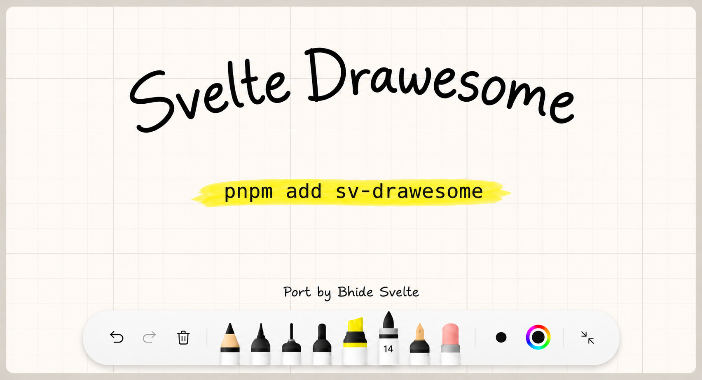

# Svelte Drawesome



Svelte Drawesome is a drawing toolbar for Svelte 5.
Seven pens, an eraser, undo and redo, plus SVG and PNG export.

## Installation

```sh
pnpm add sv-drawesome
```

## Quick start

`Draw` fills its parent, so give the parent an explicit height.

```svelte
<script lang="ts">
	import { Draw } from 'sv-drawesome';
</script>

<div class="canvas">
	<Draw />
</div>

<style>
	.canvas {
		height: min(42rem, 80vh);
	}
</style>
```

## Features

- Pencil, pen, fineliner, marker, highlighter, brush, and fountain pen
- Mouse, touch, and stylus input with pressure support
- Erasing, undo, redo, and clear controls
- SVG and high-resolution PNG export
- Light, dark, and system themes
- Configurable tools, colors, controls, and toolbar placement
- Keyboard shortcuts and tooltips

## Usage

### Configure the toolbar

Pick the tools and colors you need. The toolbar can sit on any supported edge or be dragged into place.

```svelte
<script lang="ts">
	import { Draw, type DrawControls, type PenId } from 'sv-drawesome';

	const tools: PenId[] = ['pencil', 'pen', 'marker', 'brush'];
	const controls: DrawControls = {
		custom: false,
		opacity: false
	};
	const swatches = ['#111111', '#e63946', '#457b9d', '#2a9d8f'];
</script>

<div class="canvas">
	<Draw
		background="checker"
		placement="left"
		theme="auto"
		{tools}
		{controls}
		{swatches}
		settings="tool"
		depth="soft"
		draggable
		gauge
	/>
</div>

<style>
	.canvas {
		height: 36rem;
		border-radius: 1rem;
	}
</style>
```

### Track and restore strokes

`onChange` receives the full stroke list. Pass saved strokes to `initialStrokes` when the component is created.

```svelte
<script lang="ts">
	import { Draw, type Stroke } from 'sv-drawesome';

	let strokes = $state<Stroke[]>([]);

	function updateStrokes(updatedStrokes: Stroke[]) {
		strokes = updatedStrokes;
	}
</script>

<div class="canvas">
	<Draw initialStrokes={strokes} onChange={updateStrokes} />
</div>

<p>{strokes.length} strokes</p>

<style>
	.canvas {
		height: 36rem;
	}
</style>
```

### Export a drawing

Bind the component to call its export methods. PNG scale defaults to `2`.

```svelte
<script lang="ts">
	import { Draw, type DrawHandle } from 'sv-drawesome';

	let drawing: DrawHandle;

	async function downloadSvg() {
		await drawing.download('sketch', 'svg');
	}

	async function downloadPng() {
		await drawing.download('sketch', 'png', 2);
	}
</script>

<div class="canvas">
	<Draw bind:this={drawing} />
</div>

<div class="actions">
	<button onclick={downloadSvg}>Download SVG</button>
	<button onclick={downloadPng}>Download PNG</button>
</div>

<style>
	.canvas {
		height: 36rem;
	}

	.actions {
		display: flex;
		gap: 0.5rem;
		margin-top: 1rem;
	}
</style>
```

## Common props

| Prop                | Type                                        | Default          | Purpose                                                                        |
| ------------------- | ------------------------------------------- | ---------------- | ------------------------------------------------------------------------------ |
| `background`        | `string`                                    | `'#ffffff'`      | A CSS color, `'transparent'`, or `'checker'`                                   |
| `board`             | `{ w: number; h: number }`                  | container size   | Fixes the drawing coordinate space                                             |
| `initialStrokes`    | `Stroke[]`                                  | `[]`             | Seeds the drawing when the component is created                                |
| `onChange`          | `(strokes: Stroke[]) => void`               | -                | Runs when the stroke list changes                                              |
| `tools`             | `PenId[]`                                   | all seven pens   | Chooses and orders the available pens                                          |
| `eraser`            | `boolean`                                   | `true`           | Shows or hides the eraser                                                      |
| `controls`          | `DrawControls`                              | all enabled      | Toggles color, size, opacity, undo, clear, custom color, and minimize controls |
| `placement`         | `'bottom' \| 'left' \| 'right'`             | `'bottom'`       | Places the toolbar on an edge                                                  |
| `align`             | `'start' \| 'center' \| 'end'`              | `'center'`       | Aligns the toolbar along that edge                                             |
| `theme`             | `'light' \| 'dark' \| 'auto'`               | `'light'`        | Sets the toolbar theme                                                         |
| `look`              | `'classic' \| 'studio'`                     | `'classic'`      | Chooses the tool icon style                                                    |
| `settings`          | `'bar' \| 'tool'`                           | `'bar'`          | Places brush settings in the bar or beside each tool                           |
| `swatches`          | `string[]`                                  | built-in palette | Replaces the color palette                                                     |
| `ink`               | `'shared' \| 'per-tool' \| 'auto'`          | `'auto'`         | Controls whether pens share a color                                            |
| `draggable`         | `boolean`                                   | `false`          | Lets the user reposition the toolbar                                           |
| `gauge`             | `boolean`                                   | `false`          | Shows the current brush size on tool icons                                     |
| `startMinimized`    | `boolean`                                   | `false`          | Starts with the toolbar collapsed                                              |
| `drawWhenMinimized` | `boolean`                                   | `false`          | Keeps the surface active while the toolbar is collapsed                        |
| `shortcuts`         | `boolean`                                   | `true`           | Enables keyboard shortcuts                                                     |
| `tooltips`          | `boolean \| TooltipOptions`                 | `true`           | Configures or disables tooltips                                                |
| `motion`            | `'rise' \| 'none' \| MotionOptions`         | `'rise'`         | Configures the toolbar entrance and exit                                       |
| `depth`             | `'flat' \| 'soft' \| 'regular' \| 'strong'` | `'regular'`      | Sets the toolbar shadow depth                                                  |
| `class`             | `string`                                    | -                | Adds a class to the root element                                               |
| `style`             | `string`                                    | -                | Adds inline styles to the root element                                         |

All public prop and stroke types are exported from `sv-drawesome`.

## Component methods

| Method                             | Result                                    |
| ---------------------------------- | ----------------------------------------- |
| `toSvg()`                          | Returns the drawing as an SVG string      |
| `toPng(scale?)`                    | Returns a PNG `Blob`                      |
| `download(name?, format?, scale?)` | Downloads an SVG or PNG file              |
| `getStrokes()`                     | Returns the current strokes               |
| `setStrokes(strokes)`              | Replaces the current strokes              |
| `undo()` / `redo()`                | Moves through drawing history             |
| `clear()`                          | Removes every stroke                      |
| `getSize()`                        | Returns the current `{ w, h }` board size |

## Keyboard shortcuts

Shortcuts work while the page body or drawing area has focus.

| Key                                      | Action                          |
| ---------------------------------------- | ------------------------------- |
| `C`                                      | Pencil                          |
| `P`                                      | Pen                             |
| `F`                                      | Fineliner                       |
| `M`                                      | Marker                          |
| `H`                                      | Highlighter                     |
| `B`                                      | Brush                           |
| `G`                                      | Fountain pen                    |
| `E`                                      | Eraser                          |
| `[` / `]`                                | Decrease or increase brush size |
| `Cmd/Ctrl + Z`                           | Undo                            |
| `Cmd/Ctrl + Shift + Z` or `Cmd/Ctrl + Y` | Redo                            |

## Questions and bugs

Open an issue on [GitHub](https://github.com/SikandarJODD/sv-drawesome/issues).

## Credits

Svelte Drawesome is an unofficial port of [Benji Taylor's Drawesome](https://github.com/benjitaylor/drawesome). The original project and its design are documented at [benji.org/drawesome](https://benji.org/drawesome).

Maintained by [SikandarJODD](https://github.com/SikandarJODD).

## License

[MIT](LICENSE)
